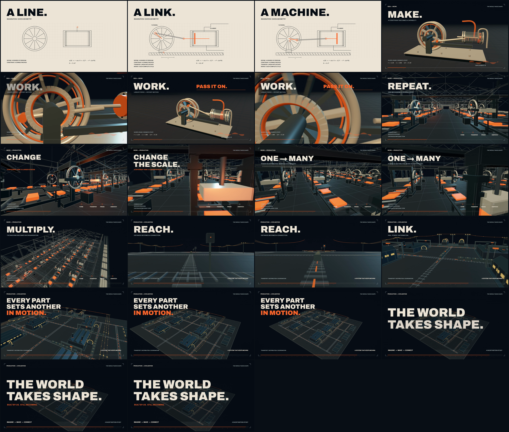

# The World Takes Shape

A **22-second silent industrial motion study** about ideas becoming machinery, machinery becoming production, and production becoming a connected world.

Built as a browser frontend with original procedural Three.js geometry, animated engineering diagrams, moving production lines, rail traffic, and a deterministic timeline. This repository preserves the original 22-second version.

**[Download the 1080p / 60 fps film](https://github.com/Epsilonmeow/the-world-takes-shape/releases/download/v1.0.0/industrial-motion-study.mp4)** · **[Release](https://github.com/Epsilonmeow/the-world-takes-shape/releases/tag/v1.0.0)**



## Run the browser version

Install [Node.js](https://nodejs.org/) 20 or newer, then run:

```sh
git clone https://github.com/Epsilonmeow/the-world-takes-shape.git
cd the-world-takes-shape
npm start
```

Open **http://127.0.0.1:5196/**. No npm packages are needed for playback: Three.js and the font are included locally. An internet connection is not required after download.

The player starts paused. Press **Space** to play or pause, **Left / Right** to move one frame, or **Shift + Left / Right** to move one second. A scrubber and replay button are also included. The player controls are in Chinese; the film uses English visual phrases.

The 16:9 composition is preserved at smaller screen sizes. A desktop display is recommended for reading the engineering details.

## The sequence

| Time | Transformation |
| --- | --- |
| 0.00–3.05 | A cursor drafts a mechanism; lines become constraints and motion. |
| 3.05–6.60 | The diagram becomes a three-dimensional drive. |
| 6.60–10.00 | A shared drive expands into repeated production stations; the camera turns to reveal another line. |
| 10.00–13.40 | Materials flow through a coordinated industrial hall. |
| 13.40–16.10 | Rail-level movement opens into transport and power connections. |
| 16.10–19.20 | Construction spreads across a working industrial territory. |
| 19.20–22.00 | The title appears over a system that keeps moving. |

The mechanisms and territory are conceptual artwork, not exact reconstructions of a historical engine or city. The film contains **no music or audio**.

## How it is rendered

- Three.js **0.180.0** and WebGL2, with original procedural geometry and instanced industrial structures.
- Animation derived from absolute time, allowing pause, seeking, repeatable frames, and offline export.
- Half-float render targets, 4× multisample antialiasing, restrained bloom, and Canvas typography composited into the final image.
- Two temporal samples for 3D frames during export; browser playback uses one sample.
- A separate headless browser sends raw RGBA frames over a local WebSocket to FFmpeg.
- The included release is H.264, **1920 × 1080, 60 fps, 22 seconds, 1,320 frames**, yuv420p / BT.709, without audio.

## Export or check the project

Playback has no npm dependencies. The optional tools require:

```sh
npm install
npx playwright install chromium
```

Install [FFmpeg](https://ffmpeg.org/download.html) separately and make `ffmpeg` available on your PATH. Keep the local server running in a second terminal, then use:

```sh
npm run check
npm run stills
npm run render
npm run verify
```

The generated video is written to `deliverables/industrial-motion-tech-demo.mp4`. Generated renders and local reports are ignored by Git.

To test a small export:

```sh
node tools/render-ws.cjs video --from 3.1 --to 3.3 --width 640 --height 360 --fps 30 --out deliverables/smoke.mp4
node tools/verify.cjs deliverables/smoke.mp4
```

Optional environment variables:

| Variable | Purpose |
| --- | --- |
| `CHROME_PATH` | Use an installed Chrome/Chromium executable instead of Playwright's bundled browser. |
| `FFMPEG_PATH` | Use a specific FFmpeg executable. |
| `DEMO_URL` | Override the player URL used by the checking tools. Render tools also accept `--url`. |
| `PORT` | Override the local server port. Default: `5196`. |

Offline output is 60 fps regardless of browser preview performance. Preview speed depends on the device and GPU. Encoding and player checks do not replace artistic judgement.

## Project layout

```text
src/main.js       Timeline, drawing layer, compositing and player
src/machine.js    Mechanical drive
src/factory.js    Production hall
src/network.js    Transport and industrial territory
vendor/          Local Three.js modules and license
assets/          Archivo variable font and license
tools/           Optional rendering and verification tools
media/           Film storyboard; full MP4 is a release asset
```

## Credits and third-party notices

Created with Codex in collaboration with the project owner.

- [Three.js](https://github.com/mrdoob/three), MIT. License: [vendor/THREE-LICENSE.txt](vendor/THREE-LICENSE.txt).
- [Archivo](https://github.com/google/fonts/tree/main/ofl/archivo), SIL Open Font License. License: [assets/Archivo-OFL.txt](assets/Archivo-OFL.txt).
- [P(doom)](https://github.com/mexicat/pdoom-video) informed the motion-quality target and technical investigation. Its artwork, renderer source, and music are not included in this project.

Third-party licenses apply to their respective files. Public availability of this repository does not add a separate license grant for the original artwork or code.
