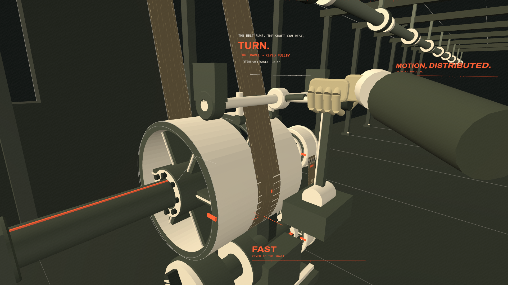

# The World Takes Shape

A **19.3-second industrial motion study** about invention becoming working machinery: steam, the separate condenser, rotary motion, a shared drive, and a local machine coming to life.

Built as a browser frontend with original procedural Three.js geometry, animated engineering diagrams, and a deterministic timeline. This version replaces the earlier silent study on the main branch; the previous source is preserved in [Git history](https://github.com/Epsilonmeow/the-world-takes-shape/tree/3b4ae481778d6dec9b27bcbfd988c321e5ea0f10).



**[Releases and video downloads](https://github.com/Epsilonmeow/the-world-takes-shape/releases)**

The v2.0.0 MP4 is prepared and awaiting manual upload. Its filename is `centuries-first-19p3-seconds.mp4`. The interactive player is ready for GitHub Pages at **https://epsilonmeow.github.io/the-world-takes-shape/** once Pages is enabled for `main` / `(root)`. Local playback is available immediately using the steps below.

## Run locally

Install [Node.js](https://nodejs.org/) 20 or newer, then run:

```sh
git clone https://github.com/Epsilonmeow/the-world-takes-shape.git
cd the-world-takes-shape
npm start
```

Open **http://127.0.0.1:5196/**. Playback requires no npm installation. Three.js, the font, and the audio excerpt are included locally, so playback works without internet access after download. Use a modern browser with WebGL2 support.

The player starts paused. **Space** plays or pauses, **Left / Right** moves one frame, and **Shift + Left / Right** moves 0.25 seconds. Replay, mute, and a scrubber are included. Controls are in Chinese; the film uses English visual phrases. The 16:9 composition is preserved at smaller screen sizes. A desktop display is recommended for reading the small engineering details.

## The sequence

| Time | Transformation |
| --- | --- |
| 0.0–1.6 | Pressure becomes motion in the cylinder. |
| 1.6–3.3 | Repeated heating and cooling reveal a problem worth solving. |
| 3.3–5.4 | A revised steam path opens into a separate space. |
| 5.4–7.5 | The condenser connection establishes a new working relationship. |
| 7.5–10.0 | The drawing becomes a spatial mechanism. |
| 10.0–12.4 | Sun-and-planet gearing turns reciprocating motion into rotation. |
| 12.4–14.8 | The flywheel carries motion forward. |
| 14.8–17.1 | A moving belt reveals the shared line shaft. |
| 17.1–19.3 | A branch belt descends; a worker shifts it from loose to fixed pulley, starting the local shaft and lathe chuck. |

Each short passage introduces a change or a reveal. Dimensions, force relationships, motion traces, and mechanical labels belong to the action instead of a separate explanatory slide. The sequence currently ends at local machine engagement; it does not yet show cutting or the full factory.

## Rendering

- Three.js **0.180.0**, WebGL2, original procedural geometry, and Canvas typography.
- Absolute-time animation supports pause, seeking, repeatable frames, and offline export.
- Four-sample render-target antialiasing, a compositing shader, restrained grain, and beat-linked motion accents.
- The browser player follows the audio clock. Offline export evaluates each frame at `i / 60`.
- A separate headless browser embeds the local modules and assets with browser network requests blocked. PNG frames are piped to FFmpeg.
- The exported MP4 is **1920 × 1080, 60 fps, 19.3 seconds, 1,158 frames**, H.264 / yuv420p / BT.709 with 48 kHz stereo AAC.

The source WAV contains a continuous **61.0–80.3 second** excerpt of **“Centuries” by Fall Out Boy**, at original speed, with a 1 dB gain reduction and 5 ms fades at the two ends. There is no splice or fade at the 17.1-second extension point. No extra vocals, lyrics, or sound effects were generated.

## Optional checks and export

Playback has no npm dependencies. Optional tools require Playwright; rendering also requires FFmpeg, while MP4 verification requires Python 3 and NumPy:

```sh
npm install
npx playwright install chromium
python -m pip install numpy
```

Install [FFmpeg](https://ffmpeg.org/download.html) separately and make `ffmpeg` available on your PATH. No local server is needed for these offline tools:

```sh
npm run check
npm run stills
npm run render
npm run verify
```

The generated video is written to `deliverables/centuries-first-19p3-seconds.mp4`. Generated renders and local reports are ignored by Git. To test a short export:

```sh
node tools/render-offline.cjs --from 17.1 --to 19.3 --width 640 --height 360
```

| Environment variable | Purpose |
| --- | --- |
| `CHROME_PATH` | Use an installed Chrome/Chromium executable instead of Playwright's bundled browser. |
| `FFMPEG_PATH` | Use a specific FFmpeg executable. |
| `PLAYWRIGHT_MODULE` | Use an existing Playwright or playwright-core module directory for optional tools. |
| `PORT` | Change the local server port; default `5196`. |

The release's [verification record](docs/verification.json) contains the complete-decode result, frame count, audio alignment checks, and SHA-256 hash. The interactive player is checked separately for playback, pause, seeking, stepping, mute, replay, ending, and mobile overflow. Offline output is 60 fps; real-time browser performance depends on the device and GPU.

## Historical foundations

- [Watt's 1765 model — Science Museum Group](https://collection.sciencemuseumgroup.org.uk/objects/co50928): separating condensation from the working cylinder avoids repeatedly cooling that cylinder. Pressure difference acts on the piston; the condenser is not a separate physical “pulling force.”
- [Sun-and-planet gearing model — Science Museum Group](https://collection.sciencemuseumgroup.org.uk/objects/co51167/model-of-sun-and-planet-gearing): the 1781 rotative design connects to the gearing passage. The date identifies the design stage, not the manufacture date of the entire depicted installation.
- [Power Hall display research — Science Museum Group Journal](https://journal.sciencemuseum.ac.uk/article/prototyping-the-power-hall-a-decision-making-process/): flywheel inertia and belt transmission inform the shift from one mechanism to distributed power.
- [Mill power drives — National Park Service](https://home.nps.gov/lowe/learn/photosmultimedia/mill_power_drives.htm): the later transmission space draws on the developing nineteenth-century factory power network rather than one exact 1781 factory.
- [Small screw-cutting lathe](https://collection.sciencemuseumgroup.org.uk/objects/co46352/small-screw-cutting-lathe) and [shaft with fast and loose pulleys](https://collection.sciencemuseumgroup.org.uk/objects/co52286/shaft-with-fast-loose-pulleys) — Science Museum Group: a loose pulley can rotate freely while the local shaft remains stopped; shifting the belt onto the fixed pulley drives the shaft. “Fast” means fixed to the shaft, not higher speed. The key remains attached to the fixed pulley and shaft; the belt changes position.

The dimensions, camera movements, cutaways, diagrams, and timing are authored visual design. Displayed angles and pulley ratios come from the depicted mechanism, not historical measurements. The work combines several stages of industrial development rather than reconstructing one complete original engine. These production notes remain outside the film.

## Project layout

```text
index.html        Chinese player interface
player.js         Audio clock, controls, seeking and playback states
src/main.js       Timeline and final compositing
src/plate.js      Opening pressure / heat / revision diagrams
src/tunnel.js     Transition into the separate condenser space
src/power-plate.js Connection diagrams
src/formation.js  Mechanism becoming spatial
src/rotary.js     Gearing, flywheel and line shaft
src/branch.js     Local belt control and lathe response
vendor/           Local Three.js modules and license
assets/           Audio excerpt, Archivo font and font license
tools/            Optional offline checks, render and verification
docs/             Release verification record
media/            A frame from the current film
```

## Credits and third-party notices

Created with Codex in collaboration with the project owner.

- [Three.js](https://github.com/mrdoob/three.js), MIT. License: [vendor/THREE-LICENSE.txt](vendor/THREE-LICENSE.txt).
- [Archivo](https://github.com/google/fonts/tree/main/ofl/archivo), SIL Open Font License. License: [assets/Archivo-OFL.txt](assets/Archivo-OFL.txt).
- **Music: “Centuries” — Fall Out Boy.** Music rights remain with the respective rights holders; this repository does not claim ownership of the recording or composition or grant a license to reuse them.
- [P(doom)](https://github.com/mexicat/pdoom-video) informed the motion-quality target and technical investigation. Its artwork, renderer source, and music are not included in this project.

Third-party licenses apply to their respective files. Public availability of this repository does not add a separate license grant for the original artwork or code.
